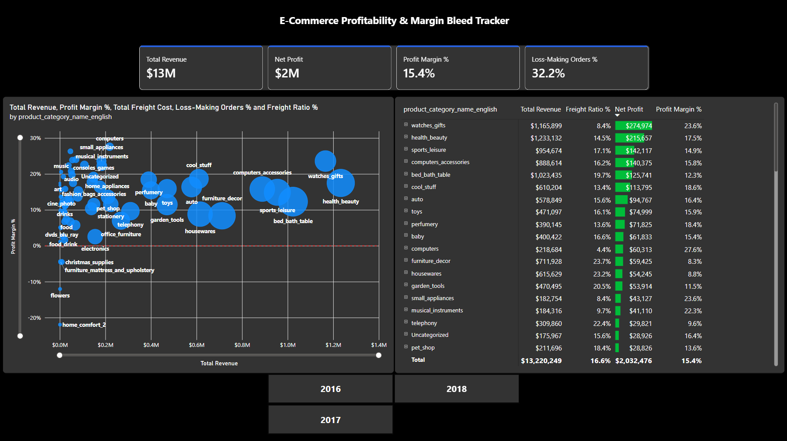
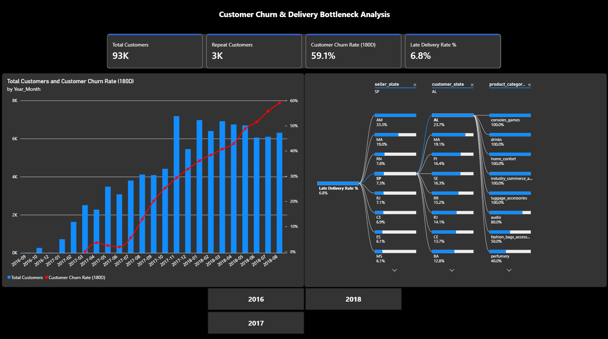
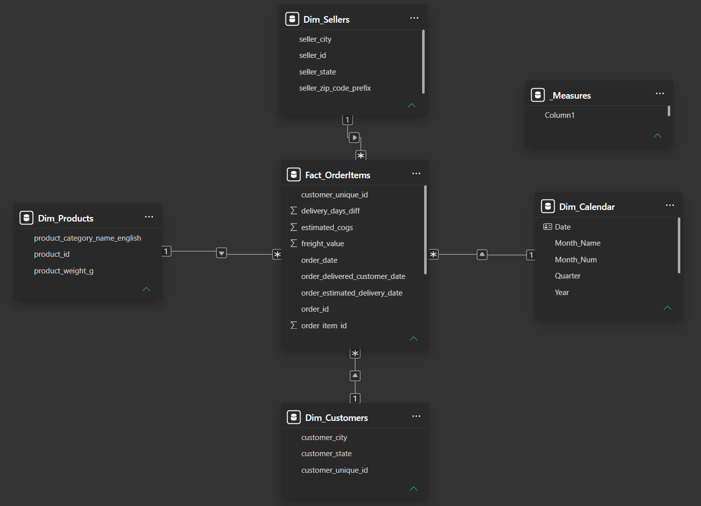

# 📊 E-Commerce Profit & Churn Dashboard (Power BI)

-217346?style=for-the-badge&logo=microsoft-excel&logoColor=white)

### 🔗 Quick Links
- 📈 **[View Live Interactive Dashboard](https://app.powerbi.com/view?r=eyJrIjoiYmExOWViNjctNzE1Zi00N2RiLTliYzMtZjVjZGI1ZWEwOWE3IiwidCI6Ijc5YTA1N2ZiLWIwZDUtNDRkZC04ZjkwLTBiZjcxNTFmNWMzZiIsImMiOjl9&pageName=c3d9c7c72681691c9e09)**
- 📄 **[View Full Dashboard PDF](./Dashboard_Report.pdf)**
- 💻 **[Download Power BI (.pbix) File](./ECommerce_Margin_Retention_Dashboard.pbix)**
- 🌐 **[Dataset: Brazilian E-Commerce by Olist (Kaggle)](https://www.kaggle.com/datasets/olistbr/brazilian-ecommerce)**

---

## 📌 About This Project
In e-commerce, high sales revenue can sometimes hide the fact that certain products are actually losing money due to expensive shipping and late deliveries. 

I built this dashboard using **112,000+ real e-commerce order records** to answer two main questions:
1. **Profitability:** Which product categories and items lose money after subtracting product costs (COGS) and shipping fees (`freight_value`)?
2. **Customer Retention & Delivery Delays:** How do late deliveries affect our **180-day customer churn rate**, and which state-to-state shipping routes have the worst delays?

---

## 🖼️ Dashboard Preview

### Page 1: Margin & Freight Analysis

- **What it shows:** Main KPI cards, a Scatter Chart with a `0%` break-even line to spot unprofitable categories, and a product Matrix with red/blue data bars to compare profitable vs. loss-making items.

### Page 2: Customer Retention & Delivery Impact

- **What it shows:** A monthly chart comparing Total Customers against the 180-Day Churn Rate, and an interactive **Decomposition Tree** to break down late deliveries by customer state, seller state, and product category.

---

## 🗂️ Data Modeling & Cleaning (Power Query)

Instead of loading all the raw CSV files into one big flat table, I cleaned and connected 6 datasets in **Power Query** to build a **5-table Star Schema** (`1:*` one-to-many relationships):
- **`Fact_OrderItems` (Main Fact Table):** Merged order dates, delivery dates, and unique customer IDs. I also filtered out canceled orders, calculated delivery delay days (`delivery_days_diff`), and created an estimated cost column (`estimated_cogs`).
- **`Dim_Customers` (Cleaned via Staging Query):** Because the raw dataset creates a new `customer_id` for every single order, I used a hidden `Staging_Customers` table to map `customer_unique_id` into the Fact table first, and then removed duplicates in `Dim_Customers` so I could track repeat buyers properly.
- **`Dim_Products`:** Merged the English category names and replaced empty (`null`) values with "Uncategorized".
- **`Dim_Sellers`:** Kept seller city and state details to analyze shipping routes.
- **`Dim_Calendar`:** Created a custom DAX calendar table sorted by year, quarter, and month.

---

## 📐 Key DAX Measures Used
I stored all custom calculations inside a separate `_Measures` table:
- **`Net Profit`**: `[Total Revenue] - SUM(Fact_OrderItems[estimated_cogs]) - [Total Freight Cost]`
- **`Loss-Making Orders %`**: Uses `FILTER(VALUES(Fact_OrderItems[order_id]), [Net Profit] < 0)` to count how many individual orders had a negative profit, divided by total orders.
- **`Customer Churn Rate (180D)`**: Uses `CALCULATETABLE` and `ALL(Dim_Calendar)` to find the percentage of past customers who haven't placed a new order in the last 180 days.
- **`Late Delivery Rate %`**: Calculates the percentage of delivered orders that arrived after the estimated delivery date (`delivery_days_diff > 0`).

---

## 💡 Key Findings
- **High Shipping Costs Hurt Heavy Items:** Bulky categories like furniture brought in high revenue, but often ended up with negative net profit whenever shipping costs went above **28–32%** of the item's price.
- **Late Deliveries Lead to One-Time Buyers:** Over **96%** of customers only bought once, and late deliveries were much more common when orders had to ship across different states.
